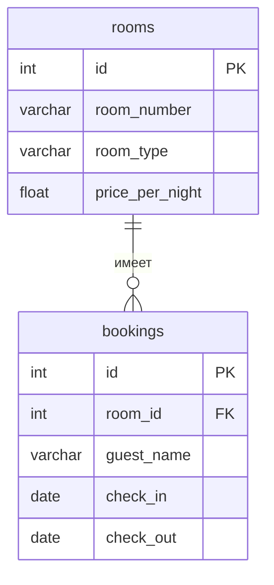

<!--
  Это шаблон README проекта. После создания своего репозитория:
  1. Переименовать репозиторий в backend-<фамилия>-<тема>, например backend-ivanova-library.
  2. Заполнить разделы ниже под свою тему и удалить этот комментарий.
  Задания лаб лежат в папке docs/, начинать с docs/README.md.
-->

# Название проекта

Тема №8: **Бронирование отелей**. Одна фраза: бронирование отелей для туристов.

| | |
| --- | --- |
| Главная сущность | Номер : номер комнаты, тип, цена за ночь /api/rooms |
| Связанная сущность (1:N) | Бронь: гость, дата заезда, дата выезда /api/rooms/{id}/bookings |
| Фишка | брони одного номера не могут пересекаться по датам. |
| Стек | Python, Flask, PostgreSQL |

## Как запустить

```bash
# команды по порядку: от git clone до работающего сервиса
```

Сервис работает на `http://localhost:8000`. Запросы для демонстрации лежат в `requests.http`.

## Эндпоинты

| Метод | Путь | Что делает | Ответ |
| --- | --- | --- | --- |
| GET | `/health` | Проверка, что сервис жив | 200 `{"status":"ok"}` |
| GET | `/api/stats/occupancy?year=2026` | Загрузка номеров по месяцам | 200 |
| POST | `/api/rooms` | Создать Номер| 201 и объект с `id`; 400 при ошибке |
| GET | `/api/rooms` | Список номеров | 200 |
| GET | `/api/rooms/{id}` | Получить одну запись Номера | 200; 404 |
| PATCH | `/api/rooms/{id}` | Изменить данные Номера | 200; 400; 404 |
| DELETE | `/api/rooms/{id}` | Удалить Номер | 204; 404 |
| POST | `/api/rooms/{id}/bookings` | Создать бронь на определенный Номер| 201; 409 при пересечении; 400; 404 |
| GET | `/api/rooms/{id}/bookings` | Список броней номера | 200; 404|
| GET | `/api/bookings/{id}` | Получить одну Бронь | 200; 404 |
| PATCH | `/api/bookings/{id}` | Изменить данные брони | 200; 409; 400; 404 |
| DELETE | `/api/bookings/{id}` | Удалить Номер | 204; 404 |


## ER-диаграмма

<!-- С лабы 2. Блок mermaid GitHub рисует сам. -->



## Интерфейс

<!-- С лабы 4: скриншот, например  -->
